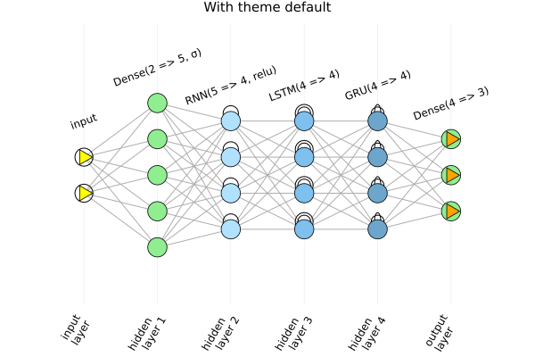
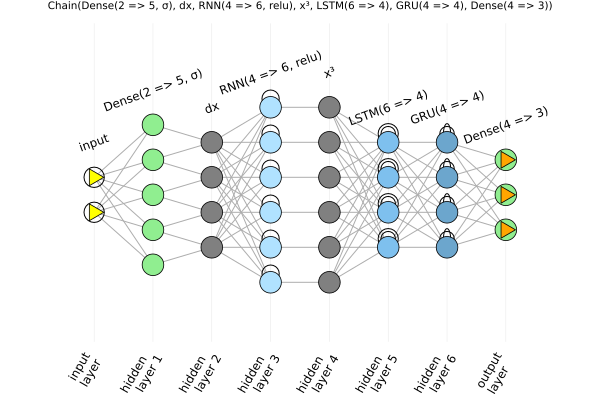
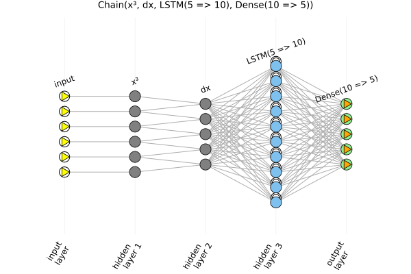
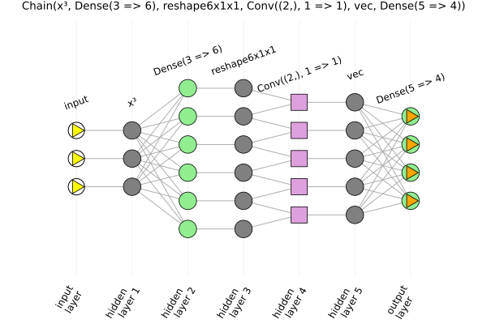
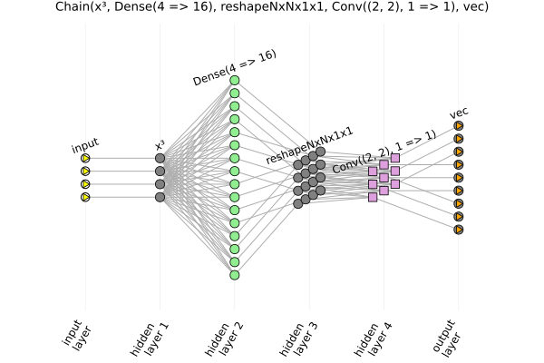
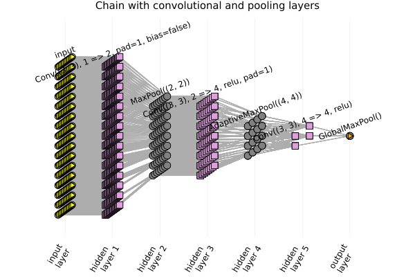
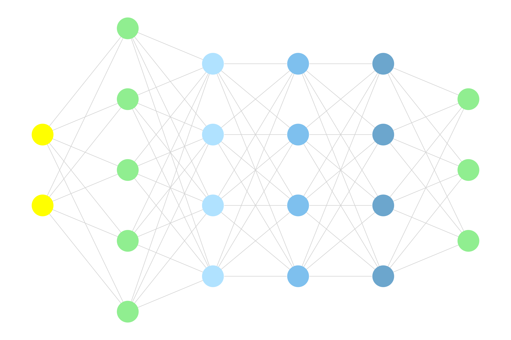

# ChainPlots

[](https://rmsrosa.github.io/ChainPlots.jl/dev/) 
 [](https://codecov.io/gh/rmsrosa/ChainPlots.jl) [](https://opensource.org/licenses/MIT)  

Graph generator and plot recipe for the topology of [FluxML/Flux.jl](https://github.com/FluxML/Flux.jl)'s neural networks composed with [Flux.Chain](https://fluxml.ai/Flux.jl/stable/reference/models/layers/#Flux.Chain).

## Description

`chaingraph(m)` builds a `ChainGraph` of the neural network `m`, with a vertex for each neuron and an edge for each connection between neurons of consecutive layers. A `ChainGraph` is a [JuliaGraphs/Graphs.jl](https://github.com/JuliaGraphs/Graphs.jl) graph, and it has a plot recipe, made with [JuliaPlots/RecipesBase.jl](https://github.com/JuliaPlots/RecipesBase.jl), so that `plot(chaingraph(m))`, or just `plotchain(m)`, draws the network.

ChainPlots 0.2 requires Flux 0.16 and Julia 1.10 or later.

> **Upgrading from ChainPlots 0.1?** `chaingraph` now returns a `ChainGraph` instead of a `MetaGraph`, and `plot(m::Flux.Chain)` is gone. See [Migrating from 0.1 to 0.2](#migrating-from-01-to-02) below.

## Aim

The aim is to obtain a pictorial representations for all types of layers implemented with [Flux.Chain](https://fluxml.ai/Flux.jl/stable/reference/models/layers/#Flux.Chain) and in a way similar to the representations given in the following links:

* [Main Types of Neural Networks and its Applications — Tutorial](https://pub.towardsai.net/main-types-of-neural-networks-and-its-applications-tutorial-734480d7ec8e); and

* [The mostly complete chart of Neural Networks, explained](https://towardsdatascience.com/the-mostly-complete-chart-of-neural-networks-explained-3fb6f2367464).

## Current state

At the moment, the recipe has been tested with most of the layers in [Flux.jl/Basic Layers](https://fluxml.ai/Flux.jl/stable/reference/models/layers/), as well as with a number of "functional" layers (e.g. `x³ = x -> x .^ 3`, `dx = x -> x[2:end] - x[1:end-1]`), and with all activation functions in [Flux/NNlib](https://fluxml.ai/Flux.jl/stable/reference/models/nnlib/).

The recurrent layers `RNN`, `LSTM` and `GRU` are drawn folded, as a single time step, with a marker that hints at the recurrence. The recurrent cells `RNNCell`, `LSTMCell` and `GRUCell` return a tuple `(y, state)` in Flux 0.16, so they can only be drawn on their own or as the last layer of a chain.

There is, however, only partial support for multidimensional layers (convolutional and pooling layers, as well as data with multiple batches) in the sense that only 1d and 2d views are available, and with the 2d visualization not being that great, yet. But hopefully soon there will be a proper multidimensional visualization for them. Batches are collapsed into a single lot.

## How it works

There is a distinction between networks starting with a layer with fixed-size input (Dense and Recurrent) and networks starting with a layer with variable-size input (Convolutional, Pooling, and functional).

In the former case, just passing a network `m = Chain(...)` works, e.g. `plotchain(m)`. In the latter case, one needs to pass along an initial input `inp`, or input size `inpsz = size(inp)`, as the second argument, like `plotchain(m, inp)` or `plotchain(m, inpsz)`, so that the size of each layer can be figured out.

Any other argument for plot is accepted, like `plotchain(m, inp, title="Convolutional network with $(length(m)) layers", titlefont = 12)`.

`plotchain(m, inp; kwargs...)` is the same as `plot(chaingraph(m, inp); kwargs...)`. The `ChainGraph` itself, `cg = chaingraph(m)` or `cg = chaingraph(m, inp)`, gives access to the properties of each neuron, with `nodeprop(cg, v, :loc_x)` or `nodeprops(cg, v)`, and of each layer, with `layer_dimensions(cg)` and `layer_names(cg)`. The neuron properties are listed in the docstring for `ChainPlots.NODE_PROPERTIES`.

## Examples

There are several examples in the Literated file [examples/build/examples.md](examples/build/examples.md) (the source file is in  [examples/examples.jl](examples/examples.jl), with all the plots saved to the folder [examples/img](examples/img/)). The same examples are also in the [Pluto](https://plutojl.org) notebook [examples/chainplots_examples_pluto.jl](examples/chainplots_examples_pluto.jl), which uses the checkout it lives in: open it with `Pluto.run(notebook = "examples/chainplots_examples_pluto.jl")`.

Here is a little taste of it.

In all the examples below, one needs `Flux`, `ChainPlots` and `Plots`, while for the graph, one needs `Graphs`. One can also display the graph using `GraphPlot`, for which one also needs `Cairo` and `Compose`.

### Dense and Recurrent layers

````julia
julia> nnr = Chain(Dense(2 => 5, σ), RNN(5 => 4, relu), LSTM(4 => 4), GRU(4 => 4), Dense(4 => 3))
Chain(
  Dense(2 => 5, σ),                     # 15 parameters
  RNN(5 => 4, relu),                    # 40 parameters
  LSTM(4 => 4),                         # 144 parameters
  GRU(4 => 4),                          # 108 parameters
  Dense(4 => 3),                        # 15 parameters
)                   # Total: 13 arrays, 322 parameters, 1.930 KiB.

julia> plotchain(nnr, title="With theme default", titlefontsize=10)
````



### Variable-input layers

Variable-input functional layers are also accepted. If given as the first layer, then an initial input must be provided, otherwise, the input data is not needed. Here are two examples, illustrating each case.

````julia
julia> dx(x) = x[2:end] - x[1:end-1]
dx (generic function with 1 method)

julia> x³(x) = x .^ 3
x³ (generic function with 1 method)

julia> nna = Chain(Dense(2 => 5, σ), dx, RNN(4 => 6, relu), x³, LSTM(6 => 4), GRU(4 => 4), Dense(4 => 3))
Chain(
  Dense(2 => 5, σ),                     # 15 parameters
  dx,
  RNN(4 => 6, relu),                    # 66 parameters
  x³,
  LSTM(6 => 4),                         # 176 parameters
  GRU(4 => 4),                          # 108 parameters
  Dense(4 => 3),                        # 15 parameters
)                   # Total: 13 arrays, 380 parameters, 2.156 KiB.

julia> plotchain(nna, title="$nna", titlefontsize=7)
````



````julia
julia> nnx = Chain(x³, dx, LSTM(5 => 10), Dense(10 => 5))
Chain(
  x³,
  dx,
  LSTM(5 => 10),                        # 640 parameters
  Dense(10 => 5),                       # 55 parameters
)                   # Total: 5 arrays, 695 parameters, 2.973 KiB.

julia> input_data = rand(6);

julia> plotchain(nnx, input_data, title="$nnx", titlefontsize=9)
````



### Convolutional networks

A neural network with a one-dimensional convolutional layer:

````julia
julia> reshape6x1x1(a) = reshape(a, 6, 1, 1)
reshape6x1x1 (generic function with 1 method)

julia> nnrs = Chain(x³, Dense(3 => 6), reshape6x1x1, Conv((2,), 1 => 1), vec, Dense(5 => 4))
Chain(
  x³,
  Dense(3 => 6),                        # 24 parameters
  reshape6x1x1,
  Conv((2,), 1 => 1),                   # 3 parameters
  vec,
  Dense(5 => 4),                        # 24 parameters
)                   # Total: 6 arrays, 51 parameters, 572 bytes.

julia> plotchain(nnrs, rand(Float32, 3), title="$nnrs", titlefontsize=9)
````



Now with a two-dimensional convolution:

````julia
julia> reshape4x4x1x1(a) = reshape(a, 4, 4, 1, 1)
reshape4x4x1x1 (generic function with 1 method)

julia> nnrs2d = Chain(x³, Dense(4 => 16), reshape4x4x1x1, Conv((2, 2), 1 => 1), vec)
Chain(
  x³,
  Dense(4 => 16),                       # 80 parameters
  reshape4x4x1x1,
  Conv((2, 2), 1 => 1),                 # 5 parameters
  vec,
)                   # Total: 4 arrays, 85 parameters, 644 bytes.

julia> plotchain(nnrs2d, (4,), title="$nnrs2d", titlefontsize=9)
````



With convolutional and pooling layers:

````julia
julia> nncp = Chain(
           Conv((3, 3), 1 => 2, pad=(1, 1), bias=false),
           MaxPool((2, 2)),
           Conv((3, 3), 2 => 4, pad=SamePad(), relu),
           AdaptiveMaxPool((4, 4)),
           Conv((3, 3), 4 => 4, relu),
           GlobalMaxPool()
       )
Chain(
  Conv((3, 3), 1 => 2, pad=1, bias=false),  # 18 parameters
  MaxPool((2, 2)),
  Conv((3, 3), 2 => 4, relu, pad=1),    # 76 parameters
  AdaptiveMaxPool((4, 4)),
  Conv((3, 3), 4 => 4, relu),           # 148 parameters
  GlobalMaxPool(),
)                   # Total: 5 arrays, 242 parameters, 1.555 KiB.

julia> plotchain(nncp, (16, 16, 1, 1), title="Chain with convolutional and pooling layers", titlefontsize=10)
````



### From Chain to ChainGraph

With `chaingraph` we can convert a `Flux.Chain` to a `ChainGraph`, which works with the functions of `Graphs.jl`, and whose neuron properties are given by `nodeprop` and `nodeprops`.

````julia
julia> cg = chaingraph(nnr)
ChainGraph with 22 neurons, 74 connections and 5 layers:
  0: input layer (2,)
  1: Dense(2 => 5, σ) (5,)
  2: RNN(5 => 4, relu) (4,)
  3: LSTM(4 => 4) (4,)
  4: GRU(4 => 4) (4,)
  5: Dense(4 => 3) (3,)

julia> nodeprop(cg, 1, :layer_type)
:input_layer

julia> nodeprop(cg, 3, :layer_name)
"Dense(2 => 5, σ)"

julia> nodeprop(cg, 7, :index_in_layer)
(5,)

julia> first(edges(cg))
Edge 1 => 3

julia> degree(cg, 12)
8

julia> nodeprops(cg, 15)
(layer_number = 3, layer_name = "LSTM(4 => 4)", layer_type = :LSTM, index_in_layer = (4,), layer_center = 2.0, loc_x = 3.0, loc_y = 0.75, neuron_color = :skyblue2)
````

### Visualizing the graph with GraphPlot

We may also visualize the `ChainGraph` with [JuliaGraphs/GraphPlot.jl](https://github.com/JuliaGraphs/GraphPlot.jl). We use the properties `:loc_x`, `:loc_y`, and `:neuron_color` to properly position and color every neuron.

````julia
julia> locs_x = nodeprop.(Ref(cg), vertices(cg), :loc_x)
22-element Vector{Float64}:
 0.0
 0.0
 1.0
 1.0
 ⋮
 5.0
 5.0
 5.0

julia> locs_y = nodeprop.(Ref(cg), vertices(cg), :loc_y)
22-element Vector{Float64}:
 0.4166666666666667
 0.5833333333333334
 0.16666666666666666
 0.3333333333333333
 ⋮
 0.3333333333333333
 0.5
 0.6666666666666666

julia> nodefillc = [parse(Colorant, nodeprop(cg, v, :neuron_color)) for v in vertices(cg)]
22-element Vector{RGB{FixedPointNumbers.N0f8}}:
 RGB(1.0, 1.0, 0.0)
 RGB(1.0, 1.0, 0.0)
 RGB(0.565, 0.933, 0.565)
 RGB(0.565, 0.933, 0.565)
 ⋮
 RGB(0.565, 0.933, 0.565)
 RGB(0.565, 0.933, 0.565)
 RGB(0.565, 0.933, 0.565)

julia> draw(PNG("img/mg_nnr.png", 600, 400), gplot(cg, locs_x, locs_y, nodefillc=nodefillc))
````

And here is the result.



## Migrating from 0.1 to 0.2

ChainPlots 0.2 supports Flux 0.16 only, and has two breaking changes of its own:

* `chaingraph` returns a `ChainGraph` instead of a `MetaGraphs.MetaGraph`. It keeps the graph backend private, so that it can change without breaking your code, and it is a `Graphs.AbstractGraph`, so `nv`, `ne`, `vertices`, `edges`, `neighbors` and so on still work. Read the neuron properties with `nodeprop` and `nodeprops` instead of `get_prop` and `props`:

  | 0.1 | 0.2 |
  | :-- | :-- |
  | `get_prop(mg, v, :loc_x)` | `nodeprop(cg, v, :loc_x)` |
  | `get_prop.(Ref(mg), vertices(mg), :loc_x)` | `nodeprop.(Ref(cg), vertices(cg), :loc_x)` |
  | `props(mg, v)` | `nodeprops(cg, v)`, a `NamedTuple` |

* The plot recipes for `Flux.Chain` and for single Flux layers were removed, since they were type piracy. Use `plotchain` or plot the `ChainGraph`:

  | 0.1 | 0.2 |
  | :-- | :-- |
  | `plot(m)` | `plotchain(m)` or `plot(chaingraph(m))` |
  | `plot(m, input; kwargs...)` | `plotchain(m, input; kwargs...)` |
  | `plot!(m, ...)` | `plotchain!(m, ...)` |

With Flux 0.16, layers are built with `in => out`, e.g. `RNN(5 => 4, relu)` instead of `RNN(5, 4, relu)`, and the `:layer_type` of a recurrent layer is now that of the layer itself, e.g. `:RNN`, instead of that of its cell, `:RNNCell`. See the [migration page](https://rmsrosa.github.io/ChainPlots.jl/dev/migration/) of the documentation for the details.

## Roadmap

There is a lot to be done:

* Add Documentation.
* Proper visualization for multidimensional layers.
* Optimization of the plot recipe (large networks - with hundreds of neurons - take too long, and sometimes plotting seem to hang, but building just the graph works fine).
* Add other plotting options (e.g. not annotate the plot with the type of the layer; only use circles as markers since they are accepted by all the backends).
* Improve coverage.
* Make it work across different backends.
* Make sure it works with all types of layers in `Flux.jl`.

Once it is in a more polished state, this package might be transfered to the [FluxML organization](https://github.com/FluxML).

## Compatibility

All the above works fine with the `GR` backend for `Plots.jl`. There are many [Plots backends](https://docs.juliaplots.org/latest/backends/), however, which have some issue:

* Get Warning: `pyplot()` backend does not have `:rtriangle` and seems not to scale properly.

* Get Error: `plotly()` and `plotlyjs()` do not support custom shapes.

* `hdf5()` works partially. Neurons are not showing up. On the other hand, despite saying in Plots's page that it is currently missing support for SeriesAnnotations, this seems to be working, since SeriesAnnotations is used to display the type/activation function of each layer.

* `unicodeplots()` does not accept custom shapes, nor :rtriangle. Should choose from: [:none, :auto, :circle].

* Have not tried others.
