# Examples

The aim of `ChainPlots.jl` is to provide a visualization of the topology of a neural network constructed with `Flux.Chain`. It does that by first building a `ChainGraph` of the network, with `chaingraph`, and then applying the `Plots.jl` recipe for `ChainGraph`.

Here, we consider some examples of building both a `ChainGraph` and some plots.

## Load Packages

First we load some packages:

````julia
using Flux
using Plots
using Random
using Colors
using Cairo
using Compose
using Graphs
using GraphPlot
````

and, of course, `ChainPlots`:

````julia
include("../src/ChainPlots.jl")

using .ChainPlots
````

We play with different themes for `Plots.jl`, so we collect them here:

````julia
themes = [
    :default
    :dark
    :ggplot2
    :juno
    :lime
    :orange
    :sand
    :solarized
    :solarized_light
    :wong
    :wong2
    :gruvbox_dark
    :gruvbox_light
]
````

````
13-element Vector{Symbol}:
 :default
 :dark
 :ggplot2
 :juno
 :lime
 :orange
 :sand
 :solarized
 :solarized_light
 :wong
 :wong2
 :gruvbox_dark
 :gruvbox_light
````

We start with the default one:

````julia
gr()
theme(:default)
````

## Chain to ChainGraph

We first consider a neural network with several different types of layers and building a `ChainGraph` from it.

Here is the neural network:

````julia
nnr = Chain(Dense(2 => 5, σ), RNN(5 => 4, relu), LSTM(4 => 4), GRU(4 => 4), Dense(4 => 3))
````

````
Chain(
  Dense(2 => 5, σ),                     # 15 parameters
  RNN(5 => 4, relu),                    # 40 parameters
  LSTM(4 => 4),                         # 144 parameters
  GRU(4 => 4),                          # 108 parameters
  Dense(4 => 3),                        # 15 parameters
)                   # Total: 13 arrays, 322 parameters, 1.930 KiB.
````

The `ChainGraph` is built with the function `chaingraph`:

````julia
cg_nnr = chaingraph(nnr)
````

````
ChainGraph with 22 neurons, 74 connections and 5 layers:
  0: input layer (2,)
  1: Dense(2 => 5, σ) (5,)
  2: RNN(5 => 4, relu) (4,)
  3: LSTM(4 => 4) (4,)
  4: GRU(4 => 4) (4,)
  5: Dense(4 => 3) (3,)
````

We can already see the number of vertices (neurons) and edges (connections) in this graph, as well as the dimensions of each layer.

A `ChainGraph` is a `Graphs.AbstractGraph`, so the functions of `Graphs.jl` work on it:

````julia
nv(cg_nnr), ne(cg_nnr), neighbors(cg_nnr, 1)
````

````
(22, 74, [3, 4, 5, 6, 7])
````

We can also look at the first vertex for all the properties it contains, with `nodeprops`:

````julia
nodeprops(cg_nnr, 1)
````

````
(layer_number = 0, layer_name = "input layer", layer_type = :input_layer, index_in_layer = (1,), layer_center = 1.0, loc_x = 0.0, loc_y = 0.4166666666666667, neuron_color = :yellow)
````

The two properties `loc_x` and `loc_y` give the coordinates of each vertex, while `neuron_color` gives the color based on the type of layer, whether dense, recurrent, convolutional, etc.

We can get one of those properties for all the vertices with `nodeprop`, and use them to plot the topology of the network with `GraphPlot`:

````julia
locs_x = nodeprop.(Ref(cg_nnr), vertices(cg_nnr), :loc_x)
locs_y = nodeprop.(Ref(cg_nnr), vertices(cg_nnr), :loc_y)
nodefillc = [parse(Colorant, nodeprop(cg_nnr, v, :neuron_color)) for v in vertices(cg_nnr)]
plt = gplot(cg_nnr, locs_x, locs_y, nodefillc=nodefillc)
````
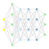

````julia
draw(PNG("img/mg_nnr.png", 600, 400), plt)
````

## Now with Plots.jl

It is easier, however, to use the `Plots.jl` recipe for `ChainGraph`, as in `plot(cg_nnr)`:

````julia
plot(cg_nnr)
````
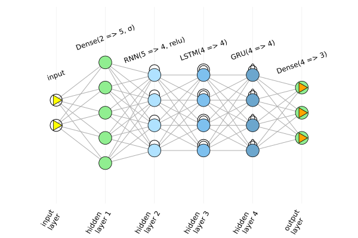

or, in one step, `plotchain(nnr)`, which is the same as `plot(chaingraph(nnr))`, as we do from now on.

### Single layer networks with fixed-size input

For illustrative purposes, we start with some simple, single-layer networks:

````julia
dl = Dense(2 => 3)
plotchain(dl, title="$dl", titlefontsize=12)
````
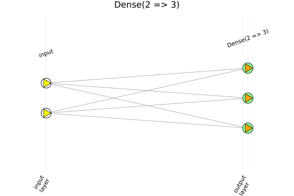

````julia
savefig("img/dl.png")
````

````
"/home/user/ChainPlots.jl/examples/img/dl.png"
````

````julia
rl = RNN(3 => 5)
plotchain(rl, title="$rl", titlefontsize=12)
````
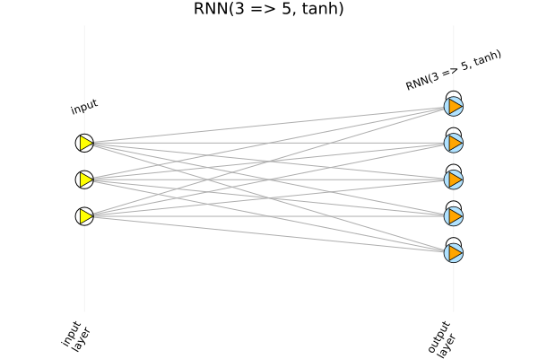

````julia
savefig("img/rl.png")
````

````
"/home/user/ChainPlots.jl/examples/img/rl.png"
````

````julia
llstm = LSTM(4 => 7)
plotchain(llstm, title="$llstm", titlefontsize=12)
````
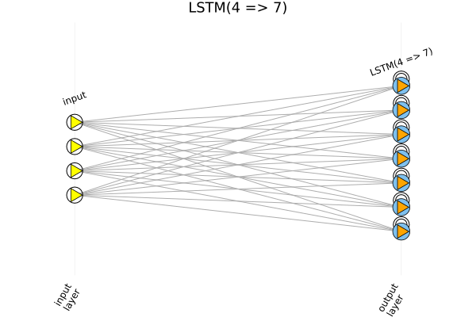

````julia
savefig("img/llstm.png")
````

````
"/home/user/ChainPlots.jl/examples/img/llstm.png"
````

````julia
lgru = GRU(5 => 7)
plotchain(lgru, title="$lgru", titlefontsize=12)
````
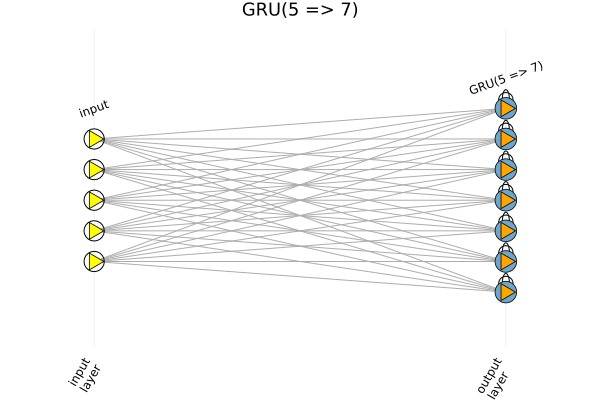

````julia
savefig("img/lgru.png")
````

````
"/home/user/ChainPlots.jl/examples/img/lgru.png"
````

## Single-layer with variable input

Some layers accept input with varied size. In this case, we need to provide either an input, in the form of a `Vector` or `Array`, or the size of the input, in the form of a `Tuple`.

````julia
lvar = Conv((2,), 1 => 1)
plotchain(lvar, rand(5, 1, 1))
````
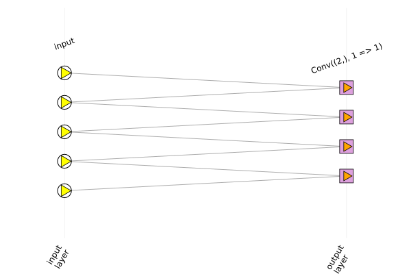

````julia
savefig("img/lvar5.png")
````

````
"/home/user/ChainPlots.jl/examples/img/lvar5.png"
````

````julia
plotchain(lvar, (8, 1, 1))
````
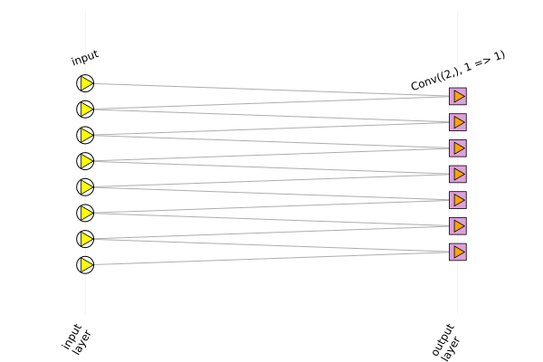

````julia
savefig("img/lvar8.png")
````

````
"/home/user/ChainPlots.jl/examples/img/lvar8.png"
````

````julia
nnc = Conv((3,3), 1=>2)
plotchain(nnc, (6, 5, 1, 1), title="$nnc", titlefontsize=10)
````
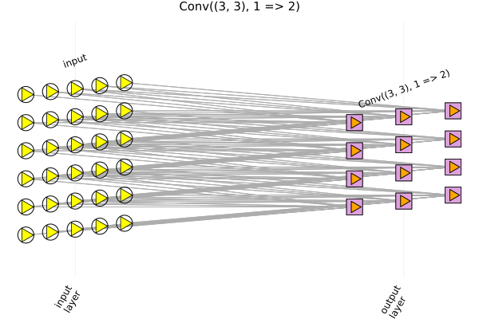

````julia
savefig("img/nnc.png")
````

````
"/home/user/ChainPlots.jl/examples/img/nnc.png"
````

## Multilayer networks

````julia
nnd = Chain(Dense(2 => 5), Dense(5 => 7, σ), Dense(7 => 2, relu), Dense(2 => 3))
plotchain(nnd, title="$nnd", titlefontsize=10, xaxis=nothing)
````
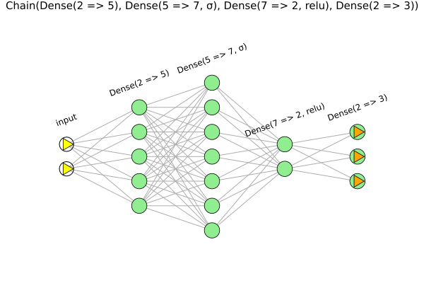

````julia
savefig("img/nnd.png")
````

````
"/home/user/ChainPlots.jl/examples/img/nnd.png"
````

````julia
nnr = Chain(Dense(2 => 5, σ), RNN(5 => 4, relu), LSTM(4 => 4), GRU(4 => 4), Dense(4 => 3))
plotchain(nnr, title="$nnr", titlefontsize=7)
````
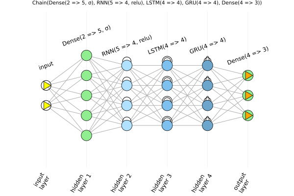

````julia
savefig("img/nnr.png")
````

````
"/home/user/ChainPlots.jl/examples/img/nnr.png"
````

````julia
x³(x) = x .^ 3
dx(x) = x[2:end] - x[1:end-1]
nna = Chain(Dense(2 => 5, σ), dx, RNN(4 => 6, relu), x³, LSTM(6 => 4), GRU(4 => 4), Dense(4 => 3))
plotchain(nna, title="$nna", titlefontsize=7)
````
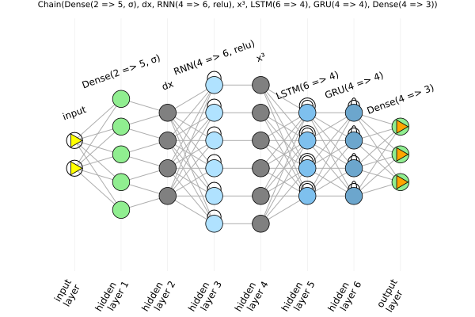

````julia
savefig("img/nna.png")
````

````
"/home/user/ChainPlots.jl/examples/img/nna.png"
````

````julia
nnx = Chain(x³, dx, LSTM(5 => 10), Dense(10 => 5))
input_data = rand(6)
plotchain(nnx, input_data, title="$nnx", titlefontsize=9)
````
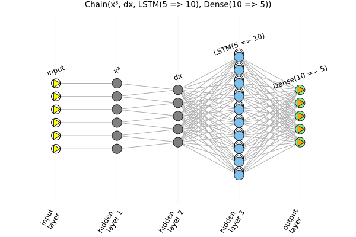

````julia
savefig("img/nnx.png")
````

````
"/home/user/ChainPlots.jl/examples/img/nnx.png"
````

or just passing the dimensions:

````julia
nnx = Chain(x³, dx, LSTM(5 => 10), Dense(10 => 5))
plotchain(nnx, (6,), title="$nnx", titlefontsize=9)
````


````julia
savefig("img/nnx_ldim.png")
````

````
"/home/user/ChainPlots.jl/examples/img/nnx_ldim.png"
````

````julia
nnrlwide = Chain(Dense(5 => 8), RNN(8 => 20), LSTM(20 => 10), Dense(10 => 7))
plotchain(nnrlwide, title="$nnrlwide", titlefontsize=9)
````
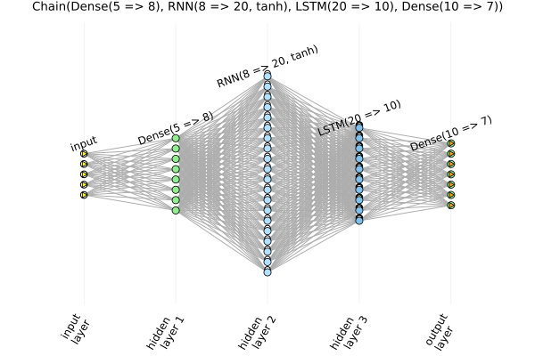

````julia
savefig("img/nnrlwide.png")
````

````
"/home/user/ChainPlots.jl/examples/img/nnrlwide.png"
````

````julia
reshape6x1x1(a) = reshape(a, 6, 1, 1)
nnrs = Chain(x³, Dense(3 => 6), reshape6x1x1, Conv((2,), 1 => 1), vec, Dense(5 => 4))
plotchain(nnrs, rand(Float32, 3), title="$nnrs", titlefontsize=9)
````
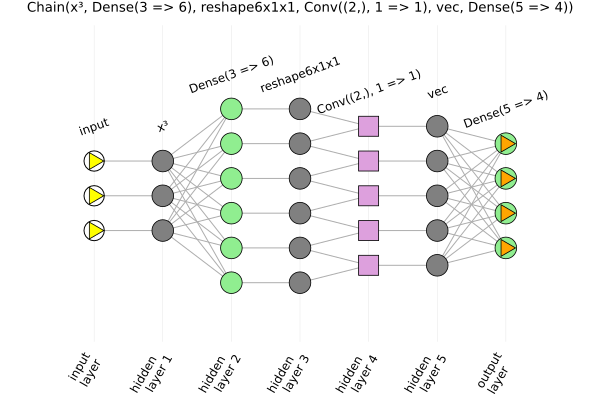

````julia
savefig("img/nnrs.png")
````

````
"/home/user/ChainPlots.jl/examples/img/nnrs.png"
````

````julia
N = 4
reshapeNxNx1x1(a) = reshape(a, N, N, 1, 1)
nnrs2d = Chain(x³, Dense(4 => N^2), reshapeNxNx1x1, Conv((2, 2), 1 => 1), vec)
plotchain(nnrs2d, (4,), title="$nnrs2d", titlefontsize=9)
````
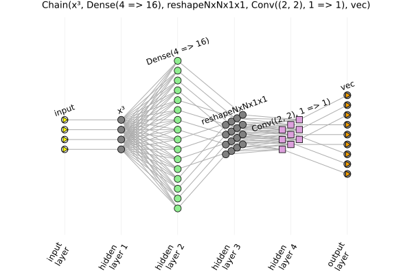

````julia
savefig("img/nnrs2d.png")
````

````
"/home/user/ChainPlots.jl/examples/img/nnrs2d.png"
````

````julia
nncg = Chain(Conv((3,3), 1=>4, leakyrelu, pad = 1),GroupNorm(4,2))
plotchain(nncg, (6,6,1,1), title="$nncg", titlefontsize=10)
````


````julia
savefig("img/nncg.png")
````

````
"/home/user/ChainPlots.jl/examples/img/nncg.png"
````

````julia
nncp = Chain(
    Conv((3, 3), 1=>2, pad=(1,1), bias=false),
    MaxPool((2,2)),
    Conv((3, 3), 2=>4, pad=SamePad(), relu),
    AdaptiveMaxPool((4,4)),
    Conv((3, 3), 4=>4, relu),
    GlobalMaxPool()
)
plotchain(nncp, (16, 16, 1, 1), title="Chain with convolutional and pooling layers", titlefontsize=10)
````


````julia
savefig("img/nncp.png")
````

````
"/home/user/ChainPlots.jl/examples/img/nncp.png"
````

````julia
hdf5()
plotchain(nnr, title="$nnr with HDF5", titlefontsize=7)
Plots.hdf5plot_write("img/nnrhdf5.hdf5")
gr()
plthdf5_read = Plots.hdf5plot_read("img/nnrhdf5.hdf5")
````
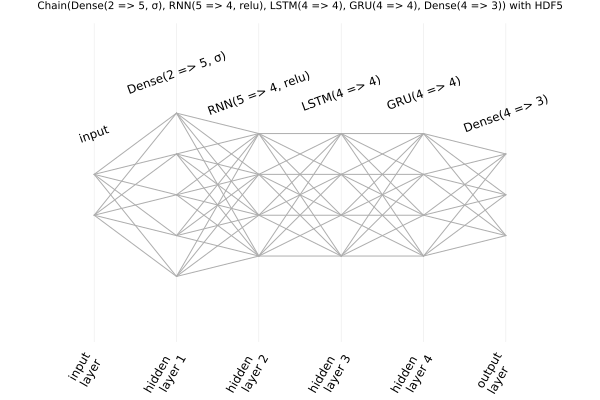

### Plotting with different themes

````julia
gr()
plts = []
for t in themes
    theme(t)
    try
        push!(plts, plotchain(nnr, title="With theme $t", titlefontsize=10, show=true))
        display(plts[end])
        #
        savefig("img/nnr_$t.png")
    catch err
        @warn "Error in chain plot with theme $t: $err"
    end
end
````


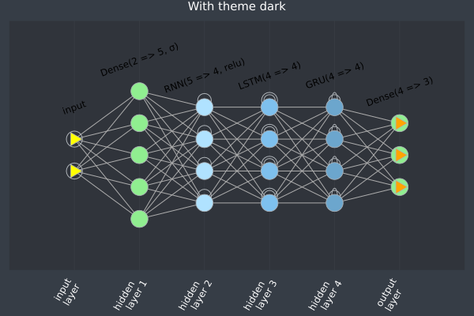
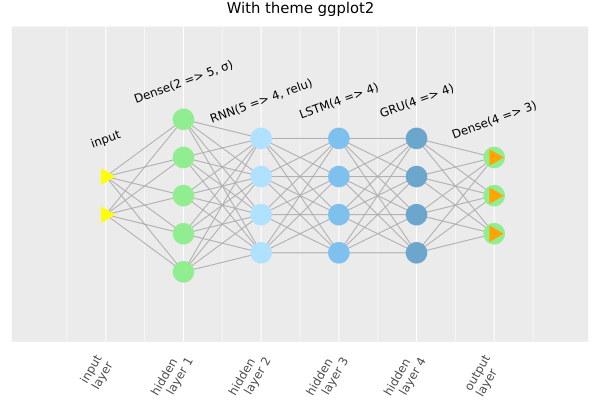
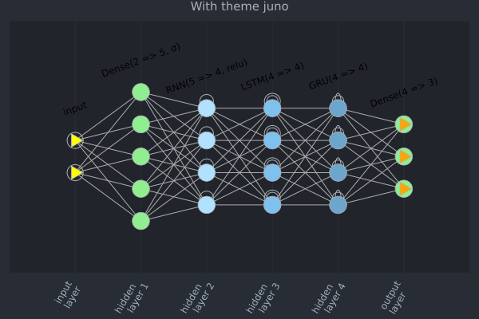
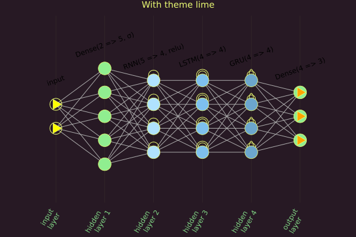
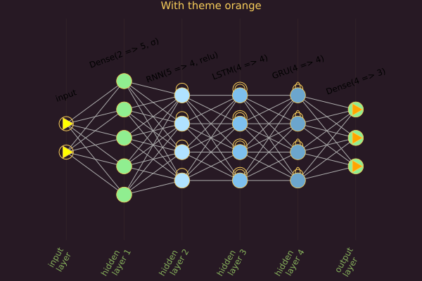
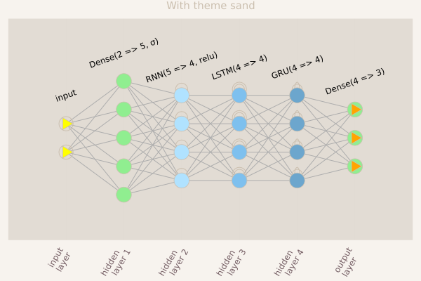
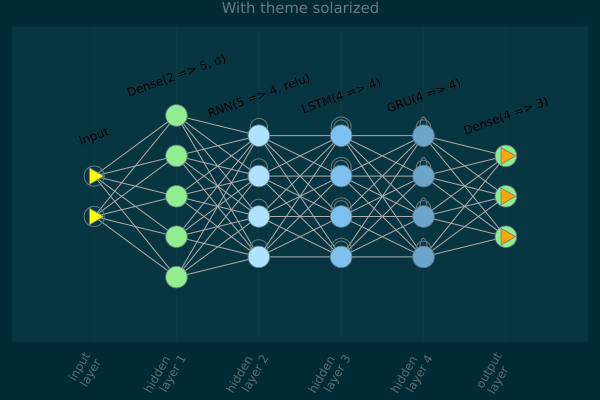
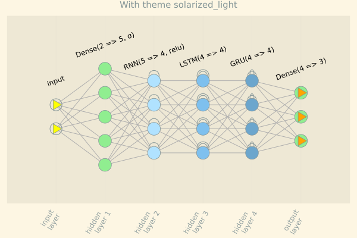
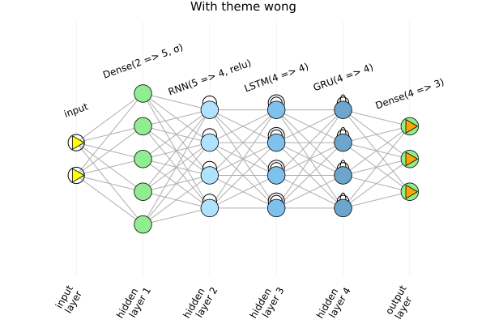
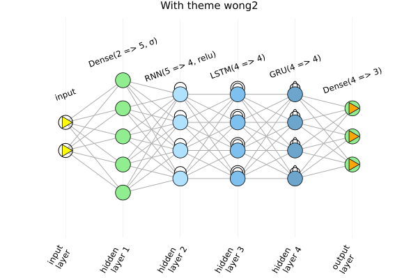
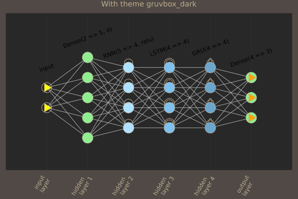
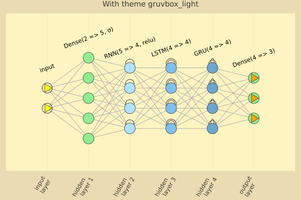

Back to `:default` theme.

````julia
theme(:default)
````

### Plotting with extra arguments

One is free to use (most of) other arguments accepted by `Plots.jl`. For instance, the following plot is used for the repo's social preview:

````julia
plotchain(nnr, title="ChainPlots.jl", topmargin=6mm, bottommargin=4mm, size=(720,380), titlefont=(42, "Bookman Demi"))
````
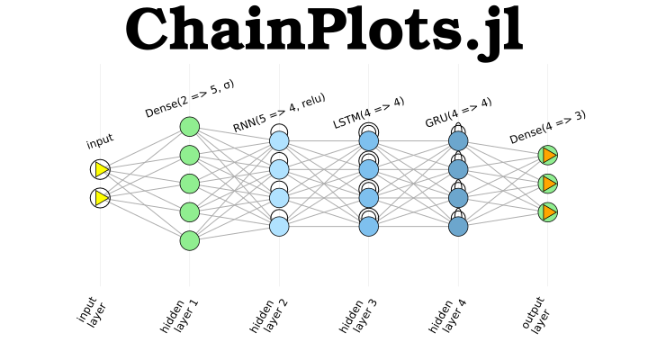

````julia
savefig("img/nnr_chainplots_socialpreview.png")
````

````
"/home/user/ChainPlots.jl/examples/img/nnr_chainplots_socialpreview.png"
````

Some attributes, like `annotationfontsize` and `markersize`, however, which are explicitly set in the Plots, recipe cannot be currently changed, but there are plans to make this more flexible.

---

*This page was generated using [Literate.jl](https://github.com/fredrikekre/Literate.jl), with `Literate.markdown("examples.jl", "build", execute = true, flavor = Literate.CommonMarkFlavor(), postprocess = s -> replace(s, r"(?!\")!\[\]\(img\/" => ", credit=false)`.*

